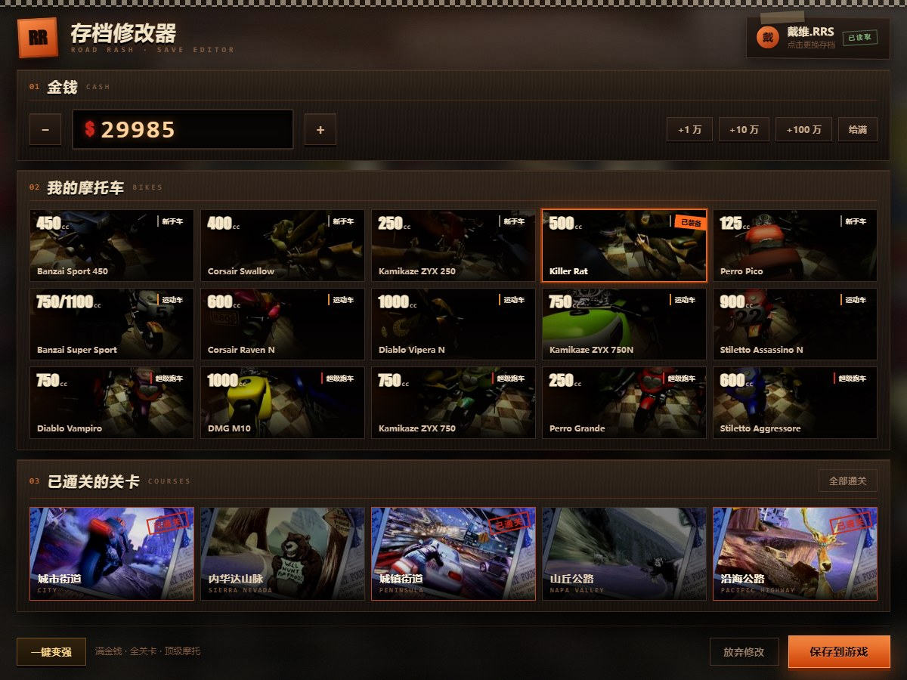
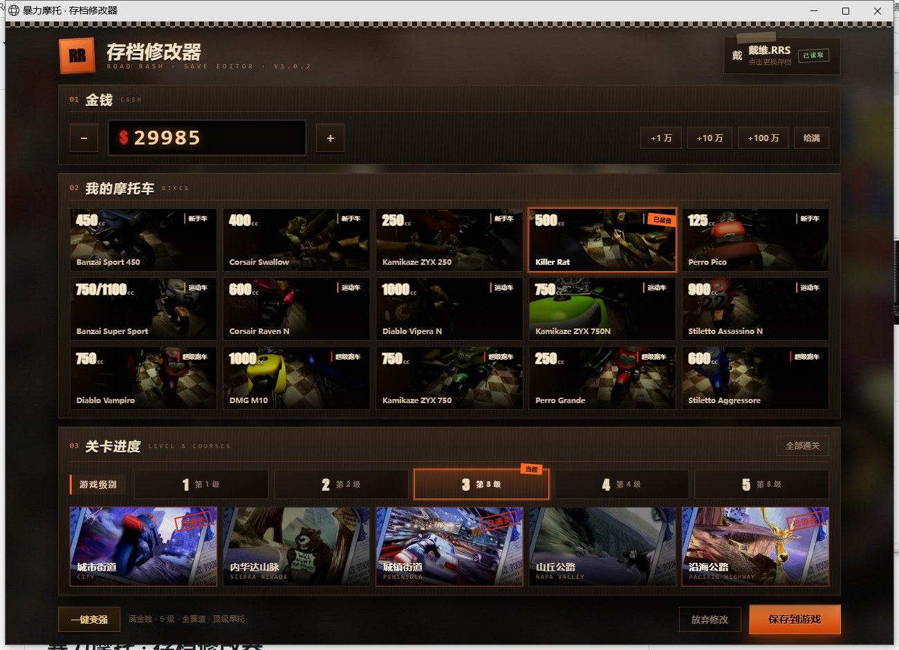

# 暴力摩托 · 存档修改器

> A tiny, dependency-free save editor for **Road Rash (1996, PC)** — edit money, motorcycle and cleared courses in a `.RRS` save.
>
> 240 KB 单文件，双击即用。零运行库依赖，界面按游戏本身的脏旧车库风格做了还原。



---

## 功能

| 能改 | 说明 |
|---|---|
| 🎚 游戏级别 | 1 ~ 5 级（主菜单上的「游戏级别：N 级」） |
| 💰 金钱 | 0 ~ 99,999,999 |
| 🏍 当前摩托车 | 15 台任选（新手车 / 运动车 / 超级跑车） |
| 🏁 已通关赛道 | 5 条赛道，逐条点亮或「全部通关」 |
| ⚡ 一键变强 | 满金钱 + 5 级 + 全赛道 + 顶级车（DMG M10） |

界面里没有任何字节、偏移、校验和——这些都在后台自动处理。

**实测界面**（窗口可自由缩放，画布等比自适应）：



## 使用

1. 双击 `暴力摩托存档修改器.exe`（首次启动需 2~5 秒，它在拉起系统 Edge 内核）；
2. 右上角显示当前存档，点它可切换（自动扫描游戏 `Save\` 目录，按最近玩过排序）；
3. 改完点 **保存到游戏**。

然后回游戏 →**载入游戏** →选这个存档即可。

> 详细说明（字段含义、推荐数值、改坏了怎么回滚、常见问题）见 **[docs/usage.md](docs/usage.md)**。

### 安全设计

- 保存前自动备份 `戴维.RRS.bak_20261116_135001`（保留最近 5 份）；
- 先写临时文件、校验长度，再覆盖原文件，任何一步失败原档不变；
- 自动重算存档头部的校验和（不重算游戏会判为「伪造进度」拒读）；
- 检测到 `Roadrash.exe` 在运行就拒绝保存（否则退出游戏时会覆盖你的修改）。

## 从源码构建

**环境**：Windows 10/11（自带 .NET Framework 4.x 与 Edge）、Python 3.9+。

```bat
pip install pillow numpy
scripts\build.bat
```

脚本会自动在注册表和常见路径里找游戏；也可以手动指定，或者不打包素材：

```powershell
.\scripts\build.ps1                        # 自动查找游戏目录
.\scripts\build.ps1 -Game "<游戏安装目录>"   # 手动指定（就是含 Images\ 的那一层）
.\scripts\build.ps1 -NoAssets              # 界面用占位背景，适合没有游戏的环境
.\scripts\build.ps1 -Zip                   # 额外产出 release zip
```

产物在 `dist\暴力摩托存档修改器.exe`。

构建过程只有两步：

1. `src/build_assets.py` 从**你本机的游戏安装**读取图片，压缩后内嵌进 `src/ui/template.html`，生成单文件 UI；
2. `csc.exe`（Windows 自带）把 UI 作为资源、和 `src/Launcher.cs` 一起编译成 exe。

> exe 运行时会在 `127.0.0.1` 起一个临时小服务给界面用，关掉窗口后自动退出，不联网。

## 命令行工具

`tools/rrs_tool.py` 是同一份格式的 Python 实现，适合批量处理或写脚本（需要 Python 3.7+）：

```bash
python tools/rrs_tool.py 戴维.RRS                              # 查看
python tools/rrs_tool.py 戴维.RRS --json                       # 机器可读
python tools/rrs_tool.py 戴维.RRS --set cash=999999 --set bike=11 -o out.RRS
python tools/rrs_tool.py 戴维.RRS --fix                        # 只重算校验和
```
## 目录结构

```
.
├─ src/
│  ├─ Launcher.cs          exe 全部逻辑：本地服务、存档读写、备份、进程检测
│  ├─ build_assets.py      从游戏目录提取素材 → 生成单文件 UI
│  └─ ui/
│     ├─ template.html     界面（HTML/CSS/JS 单文件模板）
│     └─ icon.ico
├─ tools/
│  └─ rrs_tool.py          命令行版：查看 / 修改 / 修校验和
├─ scripts/
│  ├─ build.ps1            一条命令：生成界面 + 编译 + 可选打包
│  └─ build.bat            双击版
├─ docs/
│  ├─ usage.md             使用说明（给玩家看）
│  ├─ save-format.md       存档格式（给开发者看）
│  └─ images/
└─ .github/workflows/      CI：无素材构建验证
```

## 存档格式

`.RRS` 是固定 **160 字节**的定长结构：校验和 + 魔术字 + 32 字节玩家档案 + 120 字节 AI 状态。
字段表、校验和算法、以及这些结论是怎么逆向出来的，都在 **[docs/save-format.md](docs/save-format.md)**。

## 免责声明

- 本项目为**非官方**的个人工具，与 Electronic Arts 无关联，未获其授权或背书。
- 仓库**不包含**任何游戏资源：界面图片在构建时从使用者本机的游戏目录读取（见 [NOTICE.md](NOTICE.md)）。
- 修改存档仅影响本地单人游戏体验，请自行备份；因使用本工具造成的一切后果由使用者自负。

## 许可

源代码以 [MIT License](LICENSE) 开源；游戏素材版权归其权利人所有，不在授权范围内。
